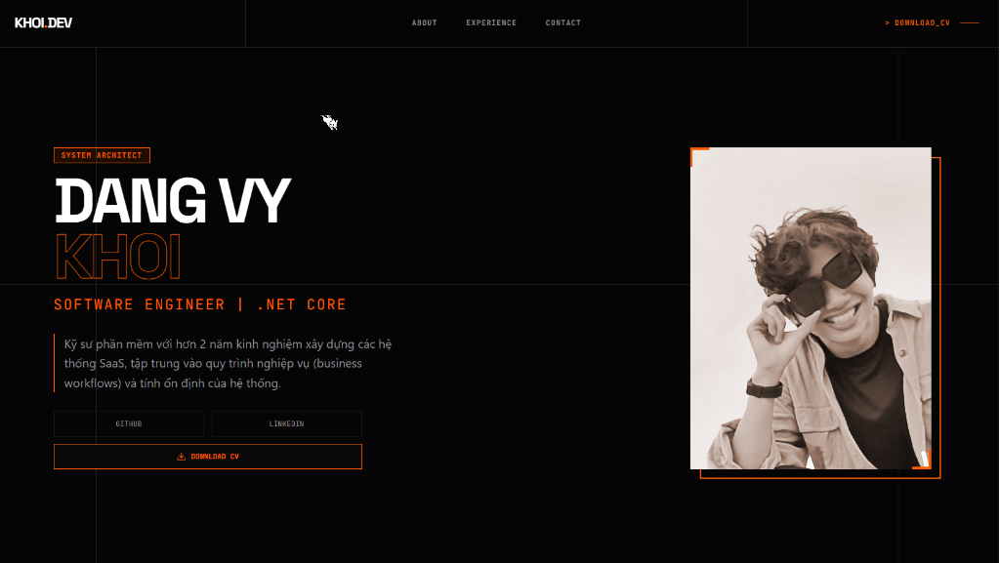
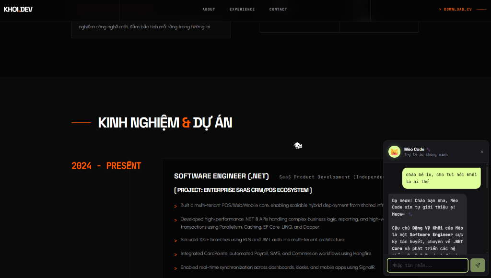
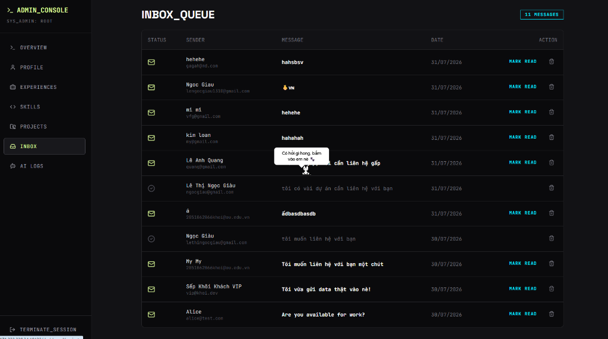
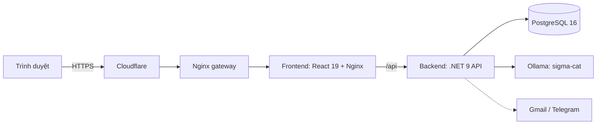

<div align="center">

# Đặng Vỹ Khôi (Dang Vy Khoi) — Portfolio

**Software Engineer (.NET Backend)**

[](https://dangvykhoi.com)
[](https://linkedin.com/in/vykhoi)
[](https://github.com/vykhoi)

`.NET 9` · `PostgreSQL 16` · `React 19` · `TypeScript` · `Tailwind` · `Ollama (Qwen2.5)` · `Docker` · `Nginx`

</div>

Trang cá nhân tự host trên home server: trang giới thiệu, trang quản trị nội dung và trợ lý AI chạy local **Sigma Cat** 😼.

| Trang chủ | Trợ lý AI Sigma Cat | Dashboard quản trị |
| :---: | :---: | :---: |
|  |  |  |

## Kiến trúc



- **Backend:** .NET 9 modular monolith, EF Core, JWT, cache in-memory, email gửi nền qua `System.Threading.Channels`.
- **AI:** Ollama + Qwen2.5 1.5B chỉ chạy trong mạng nội bộ Docker. Kiến thức nằm ở `src/Portfolio.AI`, câu hỏi phổ biến được trả lời tức thì (Fast Intent), còn lại stream qua SSE.
- **Frontend:** React 19, Vite, Tailwind, Framer Motion; SEO với JSON-LD, OpenGraph, sitemap.
- **Bảo vệ:** rate limit, honeypot chống bot (không cần captcha), secret do server quản lý.

Chi tiết: [docs/ARCHITECTURE.md](docs/ARCHITECTURE.md) · [docs/DEV_GUIDE.md](docs/DEV_GUIDE.md)

## Chạy thử

```bash
git clone https://github.com/vykhoi/Portfolio.git && cd Portfolio
cp .env.example .env
docker volume create ollama_models
docker compose up -d --build
./src/Portfolio.AI/scripts/build-model.sh      # Windows: .\src\Portfolio.AI\scripts\build-model.ps1
```

Mở http://localhost:18122. pgAdmin (tuỳ chọn): `docker compose --profile tools up -d pgadmin` → http://127.0.0.1:5050.

## Liên hệ

📧 [dangvykhoi@gmail.com](mailto:dangvykhoi@gmail.com) · 🌐 [dangvykhoi.com](https://dangvykhoi.com) · 💼 [linkedin.com/in/vykhoi](https://linkedin.com/in/vykhoi)
