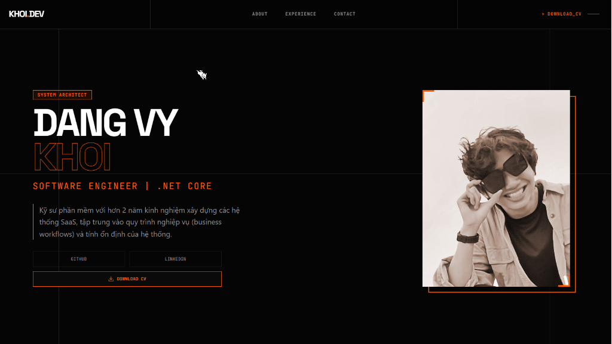
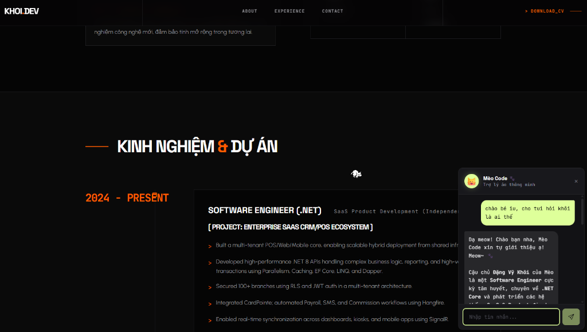
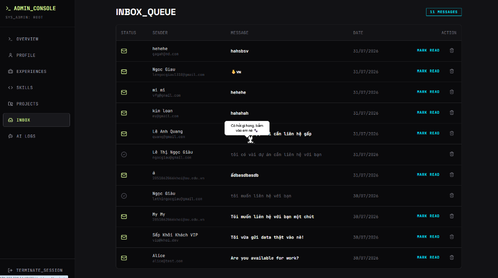

<div align="center">

# 🚀 Đặng Vỹ Khôi (Dang Vy Khoi) — Portfolio & Home Lab System

**Official Personal Portfolio & Engineering Playground of Dang Vy Khoi**  
*Software Engineer (.NET Backend) @ Masan Group*

[](https://dangvykhoi.com)
[](https://linkedin.com/in/vykhoi)
[](https://github.com/vykhoi)

<p align="center">
  
  
  
  
  
  
  
  
  
</p>

🌐 **Production Website:** [https://dangvykhoi.com](https://dangvykhoi.com)

</div>

---

## 📖 Giới Thiệu (About)

Chào mừng bạn đến với mã nguồn Portfolio chính thức của mình — **Đặng Vỹ Khôi** (Dang Vy Khoi)! 👋

Dự án này là trang cá nhân kết hợp hệ thống **Home Lab** tự vận hành trên nền tảng Docker Container, được thiết kế theo tư duy kỹ sư backend: chú trọng tính ổn định, kiến trúc module hóa, tốc độ phản hồi cao và tích hợp trí tuệ nhân tạo (Local LLM) hoàn toàn riêng tư.

- **Tác giả:** Đặng Vỹ Khôi (Dang Vy Khoi)
- **Vị trí hiện tại:** Software Engineer (.NET Backend) tại **Tập đoàn Masan (Masan Group)**
- **Học vấn:** Cử nhân CNTT loại Giỏi (Distinction) — Trường Đại học Mở TP.HCM (HCMCOU)

---

## 📸 Giao Diện & Tính Năng Nổi Bật

| Trang Chủ & Hero | Trợ Lý AI Sigma Cat | Dashboard Quản Trị |
| :---: | :---: | :---: |
|  |  |  |

---

## 🏗️ Kiến Trúc Hệ Thống (System Architecture)

```mermaid
graph TD
    Client["🌐 Client / Trình Duyệt"] -->|HTTPS / Port 443| Nginx["🛡️ Nginx Reverse Proxy (SSL, Gzip, Rate Limit)"]
    
    subgraph Docker_Network ["🐳 Portfolio Docker Bridge Network"]
        Nginx -->|Static SPA / Assets| Frontend["⚛️ Frontend Container (React 19 + Vite)"]
        Nginx -->|/api/* Requests| Backend["⚡ Backend Container (.NET 9 Web API)"]
        
        Backend -->|Dapper / EF Core| Postgres[("🐘 PostgreSQL 16 (Port 5432)")]
        Backend -->|Fast Intent Cache / Ollama SSE| AI["🐱 Ollama Container (Qwen2.5:1.5B)"]
        Backend -->|Background Worker (Channels)| Telegram["🔔 Telegram Bot Notifier"]
    end
```

---

## 🛠️ Tech Stack Chi Tiết

### 1. Backend & API (.NET 9)
* **Kiến trúc:** Modular Monolith kết hợp Clean Architecture principles.
* **ORM & Query:** Entity Framework Core cho migration dữ liệu + Dapper tối ưu hóa truy vấn đọc hiệu năng cao.
* **Xử lý bất đồng bộ:** `System.Threading.Channels` Background Worker gửi thông báo Telegram tức thì khi có tương tác hoặc liên hệ mới.
* **Bảo mật:** JWT Authentication, Rate Limiting Nginx, Honeypot ngầm chặn bot spam form mà không gây phiền người dùng bằng Captcha.

### 2. Trợ Lý AI Cục Bộ (Sigma Cat AI)
* **Mô hình:** `Qwen2.5:1.5B` chạy trực tiếp trong container Ollama độc lập, cách ly hoàn toàn với mạng ngoài để bảo mật.
* **Fast Intent Cache:** Cơ chế phân loại ý định tức thì trên C# Controller, phản hồi các câu hỏi thông dụng (kinh nghiệm, kỹ năng, liên hệ, danh tính) trong **<0.4 giây** qua Server-Sent Events (SSE).
* **System Prompt:** Định vị chú mèo trợ lý Sigma Cat nói ngôi thứ ba, ngôn phong ngắn gọn, dí dỏm và trung thực với dữ liệu hồ sơ.

### 3. Frontend & UI/UX (React 19)
* **Công nghệ:** React 19, TypeScript, Vite, Tailwind CSS, Framer Motion.
* **Tối ưu SEO:** Schema.org JSON-LD (`Person`, `WebSite`, `ProfilePage`, `FAQPage`), OpenGraph Cards, Sitemap XML và Semantic HTML Fallback giúp Googlebot cào dữ liệu tức thì ở Wave 1.
* **Easter Egg:** Mèo Oneko chạy theo con trỏ chuột tương tác nhẹ nhàng.

---

## 🌐 Các Cổng Dịch Vụ Môi Trường Lab

| Dịch vụ | Địa chỉ Local | Ghi chú |
| :--- | :--- | :--- |
| **Frontend Web** | `http://localhost:18122` | Giao diện công khai |
| **Backend Swagger** | `http://localhost:5000/swagger` | API Documentation |
| **PostgreSQL** | `localhost:5432` | CSDL chính (`portfolio_db`) |
| **pgAdmin 4** | `http://localhost:5050` | Quản trị CSDL (`admin@khoi.dev` / `admin`) |

---

## ⚡ Hướng Dẫn Chạy Thử (Quick Start)

### 1. Clone repository & chuẩn bị file môi trường
```bash
git clone https://github.com/vykhoi/Portfolio.git
cd Portfolio

cp .env.example .env
```

### 2. Khởi động các dịch vụ bằng Docker
```bash
# Tạo volume chứa model Ollama (chỉ cần tạo 1 lần)
docker volume create ollama_models

# Build và chạy toàn bộ cụm dịch vụ
docker compose up -d --build
```

### 3. Khởi tạo Model AI Sigma Cat
```bash
# Trên Windows PowerShell:
.\src\Portfolio.AI\scripts\build-model.ps1

# Hoặc trên Linux / macOS:
chmod +x src/Portfolio.AI/scripts/build-model.sh
./src/Portfolio.AI/scripts/build-model.sh
```

---

## 📬 Thông Tin Liên Hệ & Kết Nối

- **Chủ sở hữu:** Đặng Vỹ Khôi (Dang Vy Khoi)
- **Website chính thức:** [https://dangvykhoi.com](https://dangvykhoi.com)
- **Email:** [dangvykhoi@gmail.com](mailto:dangvykhoi@gmail.com)
- **Điện thoại:** 0931 314 792
- **LinkedIn:** [linkedin.com/in/vykhoi](https://linkedin.com/in/vykhoi)
- **GitHub:** [github.com/vykhoi](https://github.com/vykhoi)
- **Địa chỉ:** Gò Vấp, Thành phố Hồ Chí Minh, Việt Nam

---

<div align="center">
  <sub>Designed & engineered with ❤️ and coffee by <strong>Đặng Vỹ Khôi</strong>.</sub>
</div>
