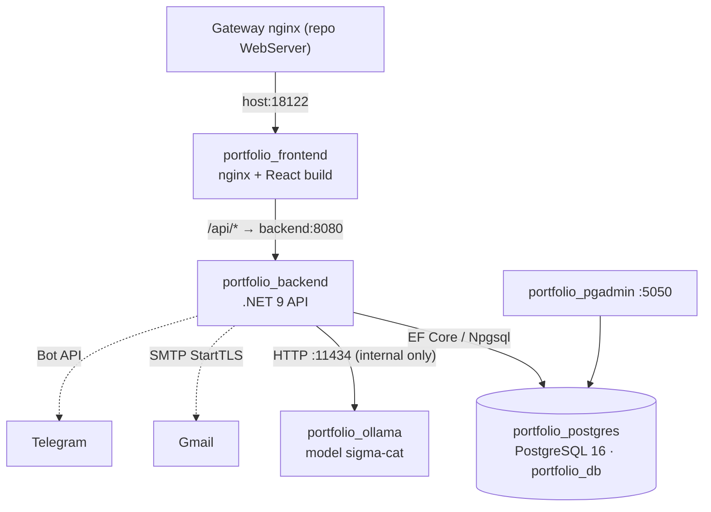

# System Architecture (Portfolio)

> Bản đồ tổng của repo. Đọc file này trước, rồi đến [FRONTEND.md](FRONTEND.md), [DEV_GUIDE.md](DEV_GUIDE.md). Chi tiết backend/AI cho AI agent: `src/Portfolio.API/CLAUDE.md`, `src/Portfolio.AI/CLAUDE.md`.

## 1. Overview

Trang cá nhân **dangvykhoi.com** gồm 3 phần trong cùng một repo:

| Phần | Thư mục | Vai trò |
| :--- | :--- | :--- |
| Backend | `src/Portfolio.API` | .NET 9 Web API (modular monolith): content CMS, contact inbox, auth admin, proxy chat AI |
| Frontend | `src/Web/frontend` | React 19 SPA: trang public + `/login` + `/dashboard` (admin console). Build ra static, chạy trong Nginx |
| AI | `src/Portfolio.AI` | Knowledge markdown + `Modelfile` để tạo model Ollama `sigma-cat` (Qwen2.5 1.5B) |

## 2. Runtime (docker-compose)

| Container | Image | Port host → container | Giới hạn |
| :--- | :--- | :--- | :--- |
| `portfolio_frontend` | build `src/Web/frontend/Dockerfile` | `18122 → 80` | — |
| `portfolio_backend` | build `src/Portfolio.API/Dockerfile` | không publish (chỉ frontend gọi) | 0.8 CPU, 512M |
| `portfolio_postgres` | `postgres:16.15-alpine` | `127.0.0.1:5432` | 0.5 CPU, 384M |
| `portfolio_ollama` | `ollama/ollama:0.40.11` | không publish | 5G RAM |
| `portfolio_pgadmin` | `dpage/pgadmin4:9` | `127.0.0.1:5050`, chỉ chạy với `--profile tools` | 384M |

- Volume `ollama_models` là **external** → phải `docker volume create ollama_models` một lần (CI tự làm).
- `src/Portfolio.AI` được mount vào ollama tại `/ai` để `ollama create -f /ai/Modelfile`.
- Frontend nginx là nơi **duy nhất** route `/api/*` vào backend, kèm rate limit riêng cho AI / contact / login (xem `src/Web/frontend/nginx.conf`).

## 3. Luồng chính

1. **Trang public:** `main.tsx` prefetch `/api/content/{profile,experience,skills}` ngay khi load → cache vào `localStorage` (stale-while-revalidate) → render không giật.
2. **Contact form:** `POST /api/contact/messages` → lưu DB → đẩy vào `ContactChannel` (in-memory) → `EmailBackgroundWorker` gửi email qua Gmail SMTP.
3. **Chat Sigma Cat:** `POST /api/ai/chat/stream` (SSE) → lưu message → báo Telegram → nếu câu hỏi khớp "Fast Intent" thì trả câu soạn sẵn, không thì stream từ Ollama → lưu reply → báo Telegram.
4. **Admin:** `/login` → `POST /api/auth/login` → JWT (7 ngày) lưu `localStorage` → `/dashboard` gọi các API `[Authorize]`.

## 4. Quyết định kiến trúc

- **Modular monolith** thay cho microservices cũ (vẫn còn route tương thích `identity/api/auth` từ thời YARP gateway).
- **IMemoryCache** 30 phút cho content public; mọi API ghi đều xoá cache key tương ứng.
- **System.Threading.Channels** thay Kafka cho hàng đợi email — mất hàng đợi nếu container restart (chấp nhận được, message vẫn nằm trong DB).
- **Prompt nằm trong model Ollama**, không nằm trong C#: backend chỉ gửi lịch sử chat (6 message gần nhất) + câu hỏi.
- **Auto-migrate + seed** khi backend khởi động (`Data/SeedData.cs`), kể cả đồng bộ mật khẩu admin theo biến `ADMIN_PASSWORD`.

## 5. Deploy

Push `main` → GitHub Actions **self-hosted runner** trên home server:
tạo `.env` từ GitHub Secrets → `docker compose down` → `build --no-cache` → `up -d` → `image prune` → `ollama pull qwen2.5:1.5b` → `ollama create sigma-cat -f /ai/Modelfile`.

Secrets cần có trên GitHub: `POSTGRES_PASSWORD`, `JWT_SECRET_KEY`, `ADMIN_PASSWORD`, `MAIL_APP_PASSWORD`, `TELEGRAM_BOT_TOKEN`, `TELEGRAM_CHAT_ID`.
