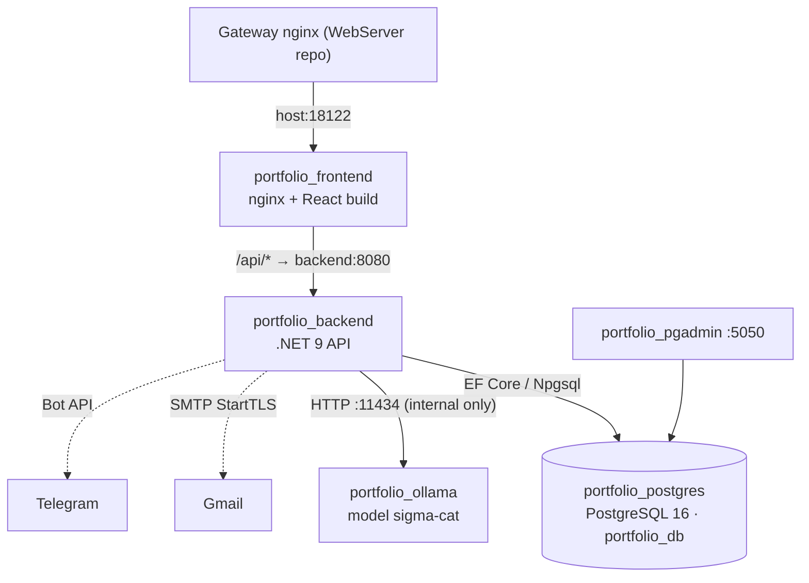

# System Architecture (Portfolio)

> Overview of the repo. Start here, then read [FRONTEND.md](FRONTEND.md) and [DEV_GUIDE.md](DEV_GUIDE.md). Backend and AI details for AI agents: `src/Portfolio.API/CLAUDE.md`, `src/Portfolio.AI/CLAUDE.md`.

## 1. Overview

The personal site **dangvykhoi.com** has 3 parts in one repo:

| Part | Folder | Role |
| :--- | :--- | :--- |
| Backend | `src/Portfolio.API` | .NET 9 Web API (modular monolith): content CMS, contact inbox, admin auth, AI chat proxy |
| Frontend | `src/Web/frontend` | React 19 SPA: public pages + `/login` + `/dashboard` (admin console). Built to static files and served by Nginx |
| AI | `src/Portfolio.AI` | Knowledge in Markdown + the `Modelfile` that creates the Ollama model `sigma-cat` (Qwen2.5 1.5B) |

## 2. Runtime (docker-compose)

| Container | Image | Host port → container | Limits |
| :--- | :--- | :--- | :--- |
| `portfolio_frontend` | built from `src/Web/frontend/Dockerfile` | `18122 → 80` | — |
| `portfolio_backend` | built from `src/Portfolio.API/Dockerfile` | not published (only the frontend calls it) | 0.8 CPU, 512M |
| `portfolio_postgres` | `postgres:16.15-alpine` | `127.0.0.1:5432` | 0.5 CPU, 384M |
| `portfolio_ollama` | `ollama/ollama:0.40.11` | not published | 5G RAM |
| `portfolio_pgadmin` | `dpage/pgadmin4:9` | `127.0.0.1:5050`, only with `--profile tools` | 384M |

- The `ollama_models` volume is **external**, so run `docker volume create ollama_models` once (CI does this itself).
- `src/Portfolio.AI` is mounted into Ollama at `/ai` for `ollama create -f /ai/Modelfile`.
- The frontend Nginx is the **only** route from `/api/*` to the backend, with separate rate limits for AI, contact and login (see `src/Web/frontend/nginx.conf`).

## 3. Main flows

1. **Public pages:** `main.tsx` prefetches `/api/content/{profile,experience,skills}` on load → caches them in `localStorage` (stale-while-revalidate) → the page renders without jumping.
2. **Contact form:** `POST /api/contact/messages` → saved to the database → pushed to `ContactChannel` (in memory) → `EmailBackgroundWorker` sends the email through Gmail SMTP.
3. **Sigma Cat chat:** `POST /api/ai/chat/stream` (SSE) → message saved → Telegram alert → a canned reply if the question matches "Fast Intent", otherwise streamed from Ollama → reply saved → Telegram alert.
4. **Admin:** `/login` → `POST /api/auth/login` → JWT (3 days) stored in `localStorage` → `/dashboard` calls the `[Authorize]` APIs.

## 4. Architecture decisions

- **Modular monolith** replaces the earlier microservices (the compatibility route `identity/api/auth` from the YARP gateway days is still there).
- **IMemoryCache** for 30 minutes on public content; every write API removes its cache key.
- **System.Threading.Channels** replaces Kafka for the email queue. The queue is lost if the container restarts, which is acceptable because the message is already in the database.
- **The prompt lives in the Ollama model**, not in C#: the backend only sends the chat history (last 6 messages) and the question.
- **Auto-migrate and seed** when the backend starts (`Data/SeedData.cs`), including syncing the admin password with `ADMIN_PASSWORD`.

## 5. Deploy

Push to `main` → GitHub Actions **self-hosted runner** on the home server: prepare secrets and `.env` → back up the database → `docker compose build` → start Postgres → `docker compose up -d` → update the `sigma-cat` model → health check → apply database updates → clean up old Docker images, build cache and unused volumes.

The Postgres password and JWT secret are generated on the server. GitHub Secrets holds `ADMIN_PASSWORD`, `MAIL_APP_PASSWORD`, `TELEGRAM_BOT_TOKEN` and `TELEGRAM_CHAT_ID`.
